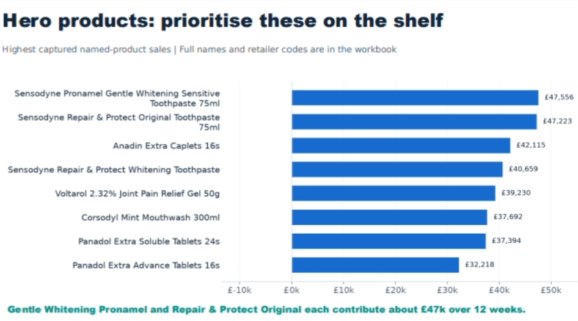
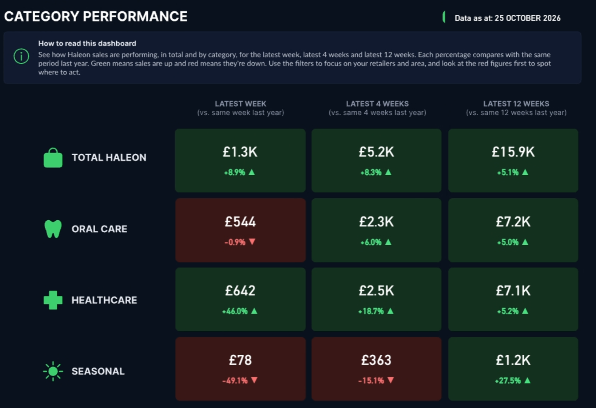
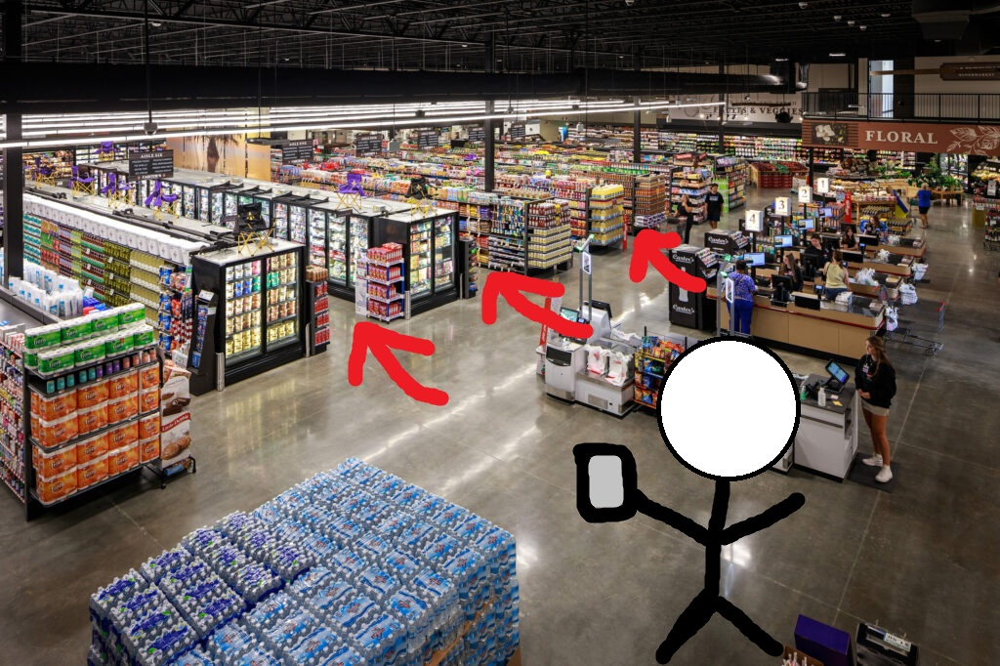
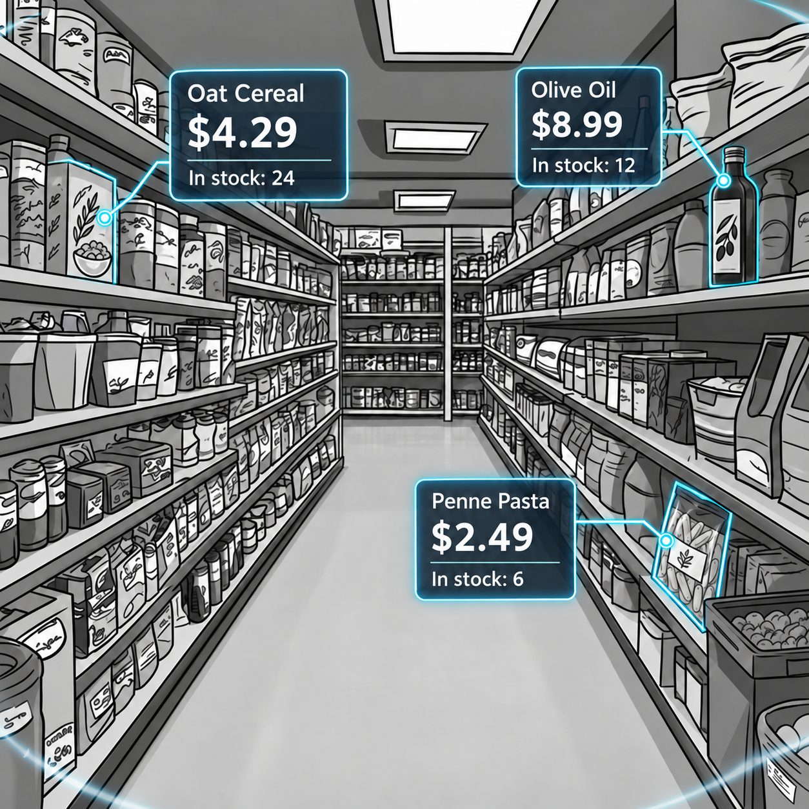
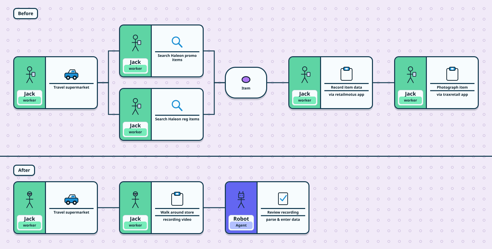

# AR Grocery Reviewer

## Background

My friend works for a field marketing company that is contracted out by Haleon which owns [many household name brands](https://www.haleon.com/our-brands). 

A main part of his job is to visit Tesco supermarkets (grocery stores) and review promotional & regular stock of Haleon products on the shelves. 

- Does this store have the current promotional items set up properly? 
- How many of Haleon Item A is on the shelf currently? 
- If it's out of stock, how many are in the back?

It's a sort of marketing-based audit of the supermarket against their suppliers.

- Data is recorded in an app called [retailmotus](https://appexchange.salesforce.com/appxListingDetail?listingId=a0N3000000B52lpEAB). 

- Photos of the shelves are also captured via some image recognition software called [Trax](https://traxretail.com/solutions/trax-image-recognition/)
  - I asked him "Why do they need photos if you're already entering relevant data in retailmotus?" and he explained that it's because they want to see the state of the product on the shelf, surrounding products, etc. In other words, companies like Haleon want tons of data to work off of in order to maximize their sales
  - 

KPI rewards are given to people like my friend. They get rewarded for finding issues (e.g. - missing stock on shelves).

**The reward is greater for high value products** compared to low value products (value == how much money the product brings in). And until this very week, the data about what products are the most valuable were not made available to the field agents.

## Workflow

The field marketing agent doesn't really have a super organized workflow. For one, they don't know where everything is inside the Tesco so they're left to figure it out. Once they get familiar with the supermarkets it becomes easier to find the specific Haleon items. It's up to the field marketing agent how they want to tackle their work.

### AR Glasses

My friend had the idea of having Meta glasses that could scan the labels of products and tell you in real time which products were highest in priority, in order to maximize his KPI. This could also be achieved with a camera and tablet as he is already given by the company (they also provide a phone and a car). I believe they would need to be familiar with the labels - right now there are 2 label types in the stores (not sure what they are) although there's talk of supermarkets moving towards digital price tags in the future in order to have dynamic pricing.

If he could scan down aisles to see which ones had the highest priority items, he could target those, reach his requirements and complete his work a lot more quickly.

But really a process like this could be automated into a robot that went up and down aisles to scan everything on the shelves and in the backrooms.

Diagram written via [Automation Illustrator](https://github.com/ashfordhill/automation-illustrator) and `.illustrator` rendered to `.svg` via this [GitHub Action](https://github.com/ashfordhill/action-illustrator-render).
