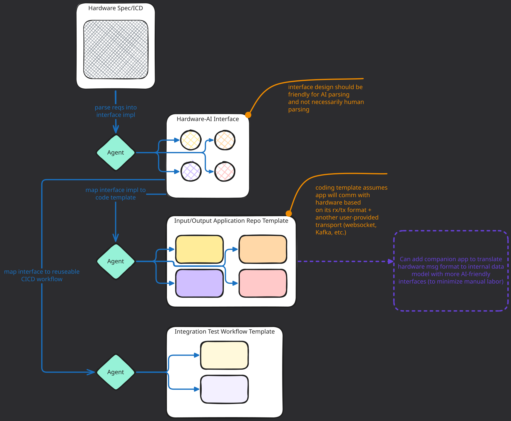

# Brainstorm

A collection of brainstorming ideas and projects.

- [Current Inventory](#current-inventory)
- [Brainstorm](#brainstorm)
  - [iMessage Commands](#imessage-commands)
    - [@factcheck](#factcheck)
    - [FAQ](#faq)
    - [Future Commands](#future-commands)
      - [@emojifusion](#emojifusion)
      - [@flip](#flip)
- 
  - [Hardware \<-\> Software Implementation: Human Labor Reduction](#hardware---software-implementation-human-labor-reduction)
  - [Archives](#archives)

## Current Inventory

- Husband's business venture (closed in 2023) with friend involved being a middleman business for Chinese sellers managing their Amazon products for US customers. Amazon charges a premium on managing returns/inventory space so it's cheaper to find third-parties in the US with warehouses to manage inventory, relabeling and returns. Basically, re-labelling old product for Amazon inventory is cheaper than paying 'stale inventory' warehouse fees on Amazon. Much of the warehouse work was just replacing barcodes on products with newer ones and sending back to the Amazon warehouse as 'new' products. Involved managing multiple client inventories without mixing them up.
  - Profitable industry but failed due to business partner not putting up promised money (whole can of worms), which left the business unable to expand on labor and properly invest in warehouse infrastructure (shelving, better tooling, etc.). 
    - Finding clients was extremely easy. More clients than what they could keep up with, without funding.
    - Probably opportunity for custom software/hardware solutions in general warehouse management. Warehouses have different tasking and goals so there isn't necessarily a "solve everything" warehouse software. Other renters in the warehouse they rented from had interesting stories and partnering opportunities.
  - I encourage husband to not give up on entrepreneurship and utilize his Chinese roots in order to gain an edge on English-speaking business owners. Can steal ideas from the East to implement sooner, find more cost effective prices for any type of manufacturer/shipper, etc.
  - Husband learned a lot through this process as he was the pretty much the sole executor for all business functions and point of contact for Chinese clients.
  - Husband's sister in France manages warehouse/inventory things successfully with her boyfriend, though for a non-Amazon market. Sister and husband very close. Mother had a successful entrepreneur lifestyle, despite minimal education (though she does not have any wealth today due to money mismanagement).

---

- Current professional work involves new DoD Consortium compliance to replace an old compliance in order to streamline businesses. 
  - Needs good developer experiences and end-user experiences are build kit for internal teams
  - Involves Kubernetes, heavy abstraction and genericism targeting different environments
  - Not as an employee but perhaps as a 1099 contractor could try to develop and sell services to DoD contractors; getting in on government money would be highly desireable if possible (?).

---

- Tree group has local political battles that are interesting to witness. I focus on collecting data around resident activity and will soon be working on advertising for said tree group since we need more people to make an impact (that's my theory, anyway).
  - Good knowledge for how things work in a non-corporate system. Sobering in realizing how slow impactful changes can be to make in complex systems with many moving parts.

---

- Awesome platonic friend who lives in Wales/England wants to get into dropshipping. High street smarts, insane amount of energy, high risk tolerance, populist personality. We've conducted interesting social experiments together. He works on his own hustles and schemes. Though not quite successful from a revenue standpoint, he never gives up and can be very energizing when I'm down in the dumps. Brainstorming partner helps organize thoughts, reduce staleness, enhance perspectives (especially from a European vs US outlook).
  - Estranged mother has successful entrepreneurship in England.

---

- Still wanting to maintain reading, meditation and maintaining physical health. I've seen how everything crumbles when physical health fails; nothing else matters and you're unable to pursue business endeavors. 

  - Taking care of myself can reduce risk of such circumstances. 
  - Reading across different domains keeps brain flexible, optimistic and fueled with fresh perspectives.
  - Violin lessons, gardening and tinkering hobbies contribute to life quality and grounding.

---

Feels like a lot of loose ends that I don't know what to do with at times; just taking things day by day!

## What Happens When Open Source LLMs Advance?

The open-source LLMs of today aren't on par with today's most expensive frontier private LLMs. However, give it a couple years (maybe longer, maybe shorter, idk. someday) and they will be just as capable as the frontier premium models of today, using less resources. 

Businesses will want to utilize open-source LLMs (handwaving security things) in order to not stay tied to token subscriptions. Tokens are not easily described in a way where you can say "X tokens will get you Y amount of work output". The current premium frontier models already aren't profitable - the subscription models are priced way too low and keep increasing in costs. These models are already advanced enough to perform a large amount of high-quality work in many fields without little human oversight. 

Internally, my company is moving towards their own VS Code fork/agent management instead of using third-party tooles and subscriptions. There are many security concerns today around open-source LLMs, but I think the idea of saving money appeals to mouth-foaming hungry business types. 

## Does AI Equate To Productivity in a Company?

Jevon's paradox.

Humans, like AI are non-deterministic factors! Some humans will innovate and contribute towards efforts that could actually increase productivity in the company. Many humans will likely pick the past of least resistance which is to have AI integrate into theirworkflows in the most simple way, performing their work for them so they can use the additional time to browse the internet (or some other activity that doesn't contribute to company productivity).

Therefore, it cannot be assumed that more AI == more productivity in the company. 

For companies truly looking to scale, you would want to be very selective with hiring and hire the 'innovate/problem-solver' types who value efficiency. Give them the tools and they can truly help streamline functions enough to replace (either mostly or entirely) certain job functions. I'm not seeing a future where it creates more jobs in this type of setting, unless the improved productivity and efficiency leads to the company venturing out into new fields/goals that would require it to hire more personnel - after all there's a limit to how much impact even the most valuable employee can have in a large corporation.

This is because the bottleneck that is being resolved is 'mental energy'. You give mental energy resource back to employees (by having them able to subcontract their work), and what is the common human tendency? To work more? Harder? Not usually. If you give a vacuum to someone with only a broom, and they are able to clean their floors in 10 minutes now instead of 15, are they going to use the saved 5 minutes to clean more? Do humans enjoy work generally (work meaning work; but what is 'work' to one person is not 'work' to another person)? It's the same way that having an 8-hr workday often doesn't mean 8hrs of productivity. And wy 4 hrs of productivity for 1 employee (e.g. - someone fresh out of college) isn't the same as 4 hrs of productivity for another employee (e.g. - someone senior and invested in positive outcomes for the company).

Because AI tools enable the general population to get more involved in software, digital tools, etc., it could become a very saturated market. On the other hand, because the field of hardware (e.g. - robotics) doesn't benefit the same growth trajectory that software does, I think that could be a more worthwhile endeavor. Let everyone chase the software goldmine and do something adjacent or unrelated, IMO (or if doing software, something niche).

Government money would also be very valuable to attain since it can be long-term and not necessarily tied to product quality but rather what metrics it passes and the shoulder-rubbing of the people involved in the deal (maybe? what do I know?).

## Reverse Engineering Cheapening

Reverse engineering can be very time and expertise-intensive type of task. However, with AI agents and all the built-in knowledge they've attained, now you can reverse engineer all sorts of software. 

See: https://github.com/storytold where someone used AI tools to reverse engineer for the Adobe suite. 

Legalities aside, I think software like this could be at financial risk for the future, considering that their IP is purely digital. Anything with a purely digital IP and doesn't involve raw creativity (music, art, etc.) is at a large risk for losing value. 

This also includes paid operating systems - there is a possibility of more platform-agnostic consumer software like video games coming into the world. 

People are even automating their home hubs because they are tired of the spying and multiple APIs (smart lights, switches, speakers, clocks, other tools). Why use all that and potentially be tied to a subscription system when you can have Claude develop your own all-in-one for your home hub while you sleep?

Mainly I have apprehension around the long-term viability of digital products. 

Also, Amazon reduced its weekly digital publishing limit from 10 items to 2 items. People are going to spam the hell out of digital content consumer platforms (music, videos, digital products on Amazon, Etsy, print-to-order, etc.). Which means high competition, which I personally like to avoid since it decreases success chances.

### Caveat: A Digital Idea

I do have a digital idea from time to time - currently I think there could be a use case for lonely only dwellers. People without friends (or sometimes a certain type of friends) will go to vloggers or Twitch streamers. They form relationships with others in the fandoms, they get attached to the main character to be watched. I have a really funny discord group and we always joke about how we should monetize some of the discussions. What if you could have a platform where people could randomly find a Discord server and listen in. They would not be allowed to talk but they could spend money on little effects, just like Twitch (spend 500 coins to make a fart noise, etc.). The Discord server could opt-in and it could generate income for it. People looking for Discords to browse - fun idea - either have a direct link or 'find random server'. It could be fun because people could share their favorite Discords by 'word of mouth' instead of having a typical landing page like YouTube. It'd be sorta like Omegle where the thrill or not knowing where you'll land next could be exciting. Naturally, the more entertaining servers would gain more followers than dead/not so entertaining servers.

Basically more of people selling themselves as content since that is something that AI can't do well (e.g. - generate an actually interesting interaction between multiple different people with varying personality types and backgrounds without sounding artificial). Plus people would have lives that fans could get invested in like "Oh Greg just had his first kid, wow I remember when he just graduated college, etc."

I like this idea but not really enough to prioritize it because it could be a challenge to advertise + . I mean sell ourselves with everything else when you account for Twitch streaming, vlogging, OnlyFans - why not funny Discord conversations and banter between groups of friends to make viewers feel less lonely?

- Written by human, reviewed by AI.

## iMessage Commands

### @factcheck

Introducing the `@factcheck` command, exclusively for iMessage! Skip that Google search and have our built-in agent quickly factcheck recent information in your conversation, sources included.

### FAQ

> Is factchecker always right?

- Yes.

> What about my privacy?

- Digital privacy is an illusion, give up.

> I don't want this feature in my phone. Can I opt out?

- This feature will be included in all iMessage chats, as a security measure per our terms of service. If wanting to opt out, users can go to `Settings -> General -> Chats -> Privacy -> Messaging -> Privacy -> iMessage -> Force SMS` and set `Force SMS` to on. 

- This setting will be on by default. Defaults are restored every phone reboot.

### Future Commands

- We are excited to add more commands in iMessage! While these are not confirmed to be future offerings, here are our current top contenders:

#### @emojifusion

`@emojifusion` is an energy-intensive command to do what users have always dreamed of: Fusing 2 emojis into 1 emoji. These are freshly generated with each command. Like a snowflake, each fusion will be unique!

#### @flip

`@flip` is for users who love a little lighthearted fun in their chats. This command will flip the chat messages for all users in the current chat to become upside down! **Note that the typing box will still remain right-side up.**

 `"I'll just reverse it by sending another @flip!"` you say? Not so fast there, cowboy! `@flip` has a 10 minute cooldown. Fun for the whole family, forever!

#

## Hardware <-> Software Implementation: Human Labor Reduction

In theory could be valuable if the framework were implemented well. It would need to be more efficient than giving an experienced SWE an AI tool to write a bunch of prompts and build the app from scratch.

Some hardware would have additional features that would not be supported by the Hardware-AI Interface, but hopefully a large majority of the implementation work for core features would be automated.

The testing framework likely has value on its own. Many non-UI apps are just data inputs and data outputs so they can be abstracted & automated.

## Archives

- [QR Code Tracking](./archives/QR%20Code%20Tracking/README.md) - Brainstorm on QR code tracking systems for physical poster distribution and location-based engagement metrics.

